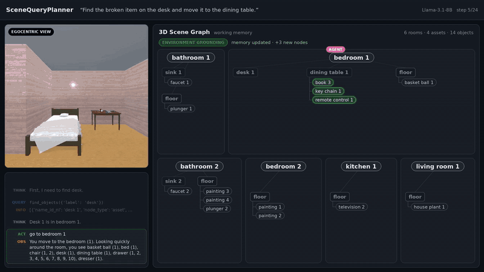
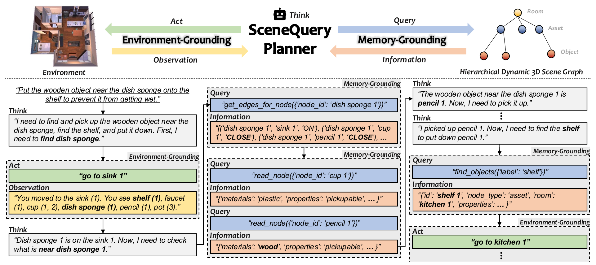

# SceneQueryPlanner

**Memory–Environment Dual-Grounding for Embodied Agents: Active Information Seeking Beyond Passive Observation**
<br>Findings of EMNLP 2026 · [Paper](https://aclanthology.org/2026.findings-emnlp.16/)

[Jae-Woo Choi](https://choi-jaewoo.github.io/)<sup>1,2,\*</sup>, Sehoon Oh<sup>3,\*</sup>, Ue-Hwan Kim<sup>3,†</sup>
<br><sup>1</sup>ETRI, <sup>2</sup>UST, <sup>3</sup>GIST &nbsp;·&nbsp; <sup>\*</sup>Equal contribution, <sup>†</sup>Corresponding author

<p align="center"></p>

SceneQueryPlanner is an LLM-based embodied task planner that treats information acquisition as a first-class planning action. Besides reasoning (`Think:`) and acting in the environment (`Act:`), the agent can `Query:` a dynamic 3D scene graph that it builds from partial observations — retrieving objects, attributes, and spatial relations on demand instead of consuming a serialized memory dump.

This repository contains the planner, all baselines compared in the paper, and both benchmarks: **AttPlan-Bench** (ours, ProcTHOR / AI2-THOR) and **WAH-NL** (VirtualHome).

## How it works

<p align="center"></p>

At each step the agent chooses one of three action types. *Environment grounding* (`Act:`) executes a skill and fuses the new local observation into the scene-graph memory; *memory grounding* (`Query:`) runs a structured query over that memory — `find_objects`, `read_node`, `get_child_node_names`, or `get_edges_for_node` — and appends the answer to the planning context. The planners available in this codebase:

| `task_planner` | Planner | Memory |
|---|---|---|
| `reactstrq` | **SceneQueryPlanner** (ours) | dynamic 3D scene graph, accessed through structured queries |
| `react` | ReAct | none (observation only) |
| `reactwm` | Naive WM | dynamic 3D scene graph, single `recall_location_of` query |
| `sayplan` | SayPlan | static full 3D scene graph, semantic search |
| `moma` | MoMa-LLM | dynamic 3D scene graph, serialized into the prompt |

## Datasets

**AttPlan-Bench** consists of long-horizon household tasks in ProcTHOR-10K houses, with two test sets. *AttPlan-Base* covers 10 ALFRED-style task types (50 episodes each). *AttPlan-Attr* (250 episodes) refers to objects by material, affordance, or spatial relation — e.g., "the item made of glass that is close to the ladle" — and includes an `AttributeHard` subset (100 episodes) whose target is identified by a state set at episode start (dirty, toggled on, broken, open, or cooked).

**WAH-NL** is the natural-language version of Watch-And-Help in VirtualHome.

| File | Episodes | Used for |
|---|---|---|
| `dataset/attplan_base_train.json` | 500 | In-context examples (AttPlan-Base) |
| `dataset/attplan_base_test.json` | 500 | AttPlan-Base evaluation |
| `dataset/attplan_attr_train.json` | 284 | In-context examples (AttPlan-Attr) |
| `dataset/attplan_attr_test.json` | 250 | AttPlan-Attr evaluation |
| `dataset/wah_nl_train_rev.json` | 250 | In-context examples (WAH-NL) |
| `dataset/wah_nl_test_rev.json` | 100 | WAH-NL evaluation |

Each AttPlan episode is `{env_id, mode, instruction, task_goal}`, where `env_id` indexes a ProcTHOR-10K test house (bundled in `core/utils/test.jsonl.gz`) and `instruction` holds up to four paraphrases, one of which is sampled per evaluation with a fixed seed. `AttributeHard` episodes additionally carry `init_action` and `init_state_hard`.

## Installation

Tested on Ubuntu 22.04 and Python 3.8 with a single NVIDIA GPU (≥ 24 GB for 8B models in fp16).

```bash
conda create -n sqp python=3.8 && conda activate sqp
pip install torch==2.4.1 --index-url https://download.pytorch.org/whl/cu118   # pick the wheel for your CUDA
pip install -r requirements.txt

export HF_TOKEN=...         # gated HF models (e.g., Llama 3.1)
export OPENAI_API_KEY=...   # only for OpenAI backends
```

**Simulators.** AI2-THOR is installed by `requirements.txt` and downloads its Unity build (~1 GB) into `~/.ai2thor/` on first use; the ProcTHOR-10K houses are bundled, so nothing else is needed. VirtualHome's Python package is vendored under `virtualhome/`; its Unity binary is downloaded in the [WAH-NL](#evaluating-on-wah-nl-virtualhome) steps below. Both simulators need an X display (`DISPLAY=:0`, or Xvfb/Xorg on a headless server).

## Evaluating on AttPlan-Bench (ProcTHOR)

```bash
sh script/procthor_05_evaluate.sh
```

The script evaluates SceneQueryPlanner with Llama-3.1-8B on AttPlan-Base (`--config-name=config_procthor`) and AttPlan-Attr (`--config-name=config_procthor_attribute`); baseline commands are included commented-out. Every entry point is a Hydra CLI, so the planner, model, prompt, and example bank can be changed with overrides:

```bash
python -m core.run.eval --config-name=config_procthor task_planner=react \
    llm_agent.model_name='Qwen/Qwen2.5-7B' \
    llm_agent.em_dir='resource/trajectory/em_llm_procthor/react' \
    llm_agent.sys_prompt_path='resource/sys_prompt/procthor/react.txt'
```

Results — Task Success Rate (TSR), Subgoal Success Rate (SSR), and the average number of decision steps — are logged per task type into `outputs/<dataset>-<planner>/<timestamp>/eval.log`.

## Evaluating on WAH-NL (VirtualHome)

1. Download the VirtualHome Unity simulator:

    ```bash
    cd virtualhome/simulation/unity_simulator/
    wget http://virtual-home.org//release/simulator/v2.0/v2.2.2/linux_exec.zip && unzip linux_exec.zip
    cd -
    ```

2. Start the simulator in a separate terminal. The Unity player opens a resolution-selection dialog on launch; for unattended runs, disable it once by renaming the plugin and pass the screen options explicitly:

    ```bash
    cd virtualhome/simulation/unity_simulator/
    mv linux_exec_Data/Plugins/x86_64/ScreenSelector.so linux_exec_Data/Plugins/x86_64/ScreenSelector.so.disabled
    ./linux_exec.x86_64 -screen-fullscreen 0 -screen-width 640 -screen-height 480
    ```

3. Evaluate (the evaluation connects to the running simulator on port 8080):

    ```bash
    sh script/wah_05_evaluate.sh
    ```

## Rebuilding the example banks

Evaluation uses the in-context example banks shipped under `resource/trajectory/`. To rebuild them from scratch, run the five stages in order for each benchmark:

| Stage | ProcTHOR | VirtualHome |
|---|---|---|
| 1. Collect human demos (interactive) | `script/procthor_01_collect_human.sh` | `script/wah_01_collect_human.sh` |
| 2. Embed human trajectories | `script/procthor_02_embed_human_traj.sh` | `script/wah_02_embed_human_traj.sh` |
| 3. Collect LLM trajectories | `script/procthor_03_collect_llm.sh` | `script/wah_03_collect_llm.sh` |
| 4. Embed LLM trajectories | `script/procthor_04_embed_llm_traj.sh` | `script/wah_04_embed_llm_traj.sh` |
| 5. Evaluate | `script/procthor_05_evaluate.sh` | `script/wah_05_evaluate.sh` |

## Repository layout

```
core/conf/       Hydra configs (config_procthor, config_procthor_attribute, config_wah)
core/run/        Entry points: eval, collect_human, collect_llm, embed_em_*
core/planner/    Planning loops, with per-simulator variants under procthor/ and wah/
core/llm_agent/  LLM interfaces (guidance; HF Transformers or OpenAI) and example retrieval
core/retriever/  Structured-query parsing and execution over the scene graph
core/wm/         Working-memory 3D scene graphs
core/env/        Simulator wrappers (procthor_env.py, wah_env.py)
dataset/         AttPlan-Bench task sets and WAH-NL splits
resource/        System prompts, object dictionaries, in-context example banks
script/          Stage-by-stage pipelines for both benchmarks
virtualhome/     Vendored VirtualHome Python package
```

## License

MIT (see [LICENSE](LICENSE)). The vendored VirtualHome package under `virtualhome/` keeps its own license (CC BY-NC-SA 4.0); see `virtualhome/LICENSE.md`.

## Citation

```bibtex
@inproceedings{choi-etal-2026-memory,
    title     = "Memory{--}Environment Dual-Grounding for Embodied Agents: Active Information Seeking Beyond Passive Observation",
    author    = "Choi, Jae-Woo and Oh, Sehoon and Kim, Ue-Hwan",
    booktitle = "Findings of the Association for Computational Linguistics: EMNLP 2026",
    year      = "2026",
    address   = "Budapest, Hungary",
    publisher = "Association for Computational Linguistics",
    url       = "https://aclanthology.org/2026.findings-emnlp.16/",
    doi       = "10.18653/2026.findings-emnlp.16",
    pages     = "317--338"
}
```
